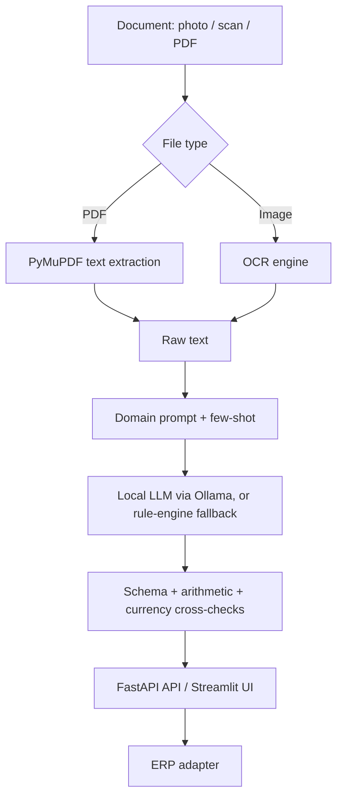

# SmartOrder

Turn photos, scans and PDFs of packaging-industry documents into validated, structured data and push them to an ERP. OCR and a **local** LLM run entirely on your own machine, so customer prices, drawings and process parameters never reach a public cloud.

## Why

Printing and corrugated-packaging companies receive many differently formatted documents: heavy-duty export carton work orders, retail gift-box specifications, e-commerce mailer-box delivery slips, delivery notes and purchase orders. Typing each one into an ERP is slow, error-prone, and requires knowing terms such as FEFCO style codes, flute types and board grades.

```
document image / PDF -> OCR -> domain-aware extraction -> business and financial checks -> human review -> ERP
```

## Features

- **Local LLM extraction** – Qwen2.5 (7B or 3B) served by Ollama, with a packaging-specific prompt and few-shot examples. Roughly 20 seconds per document on a consumer 8 GB GPU in my tests (about 6 s OCR, 16 s LLM).
- **Never-fail fallback** – if Ollama is unavailable, a built-in rule engine takes over so the system keeps working.
- **Verification layers** – Pydantic schema validation, line-item arithmetic checks, and a cross-check between numeric amounts and Chinese capital-numeral amounts to catch OCR misreads.
- **Multi-format input** – PDFs via PyMuPDF text extraction, images via OCR (RapidOCR, the PaddleOCR ONNX runtime, with EasyOCR as a fallback; images are upscaled and sharpened first).
- **ERP adapter** – pluggable `ERPAdapter` with demo targets; implement `push()` in `app/erp.py` to connect a real system.
- **Accuracy evaluation** – field-level accuracy against hand-labelled ground truth (`eval/`).
- **Deployment** – FastAPI REST API with Swagger docs, Streamlit review UI, Dockerfile and docker-compose.

## Architecture



## Getting started

```bash
pip install -r requirements.txt
streamlit run web_ui.py                              # UI on http://localhost:8501
uvicorn app.main:app --host 0.0.0.0 --port 8000      # API + docs on http://localhost:8000/docs
```

To use a real local model:

```bash
ollama run qwen2.5:7b      # or qwen2.5:3b for less VRAM
```

SmartOrder detects the running Ollama service automatically. With Docker: `docker-compose up --build`.

Demo documents are generated by `app/sample_generator.py` into `data/samples/` (all names and numbers are fictional). `requirements.txt` does not include the OCR engines: install `rapidocr-onnxruntime` (or `easyocr`) to read images.

## Configuration

Everything below lives in `config/` and needs no code changes:

| File | Content |
|---|---|
| `system_prompt.txt` | LLM extraction prompt |
| `packaging_terms.json` | Flute types, box-style keywords and special-requirement keywords for the rule engine |
| `erp_targets.json` | ERP targets (id, display name, order-number prefix) |
| `samples.json` | Titles and descriptions of the demo documents |

## Evaluation

`eval/labels/` holds ground-truth labels for the generated demo documents. Run:

```bash
python eval/evaluate.py                  # rule engine + LLM (if Ollama is running)
python eval/evaluate.py --mode rule -v   # rule engine only, list every wrong field
```

To add a case, put the image in `data/uploads/` and create a label JSON with the same structure in `eval/labels/`.

## Your own data

The repository ships without real documents. `data/uploads/` (your uploads) and the OCR cache are git-ignored.
